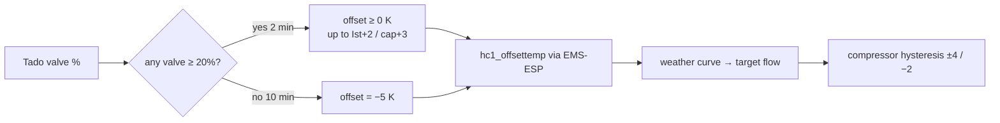
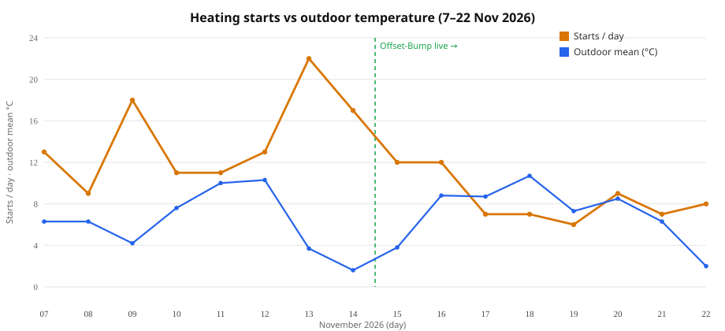
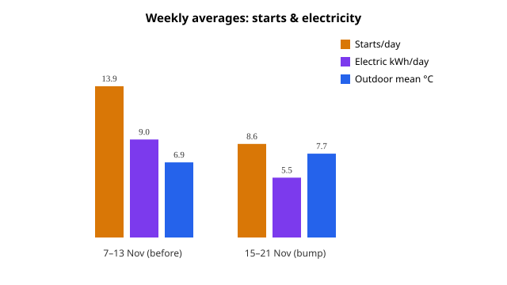

# Tado ↔ Heat Pump Offset-Bump (EMS-ESP)

> Repository name: **`tado-heatpump-offset-bump`** (preferred over “Tado-Heatpump-Integration” — this is a control pattern + field notes, not an HA custom component.)

**Bridge real radiator demand (Tado valves) into a weather-compensated heat pump that has no room unit**, by shifting only the heating-curve offset (`hc1_offsettemp`) via Home Assistant + EMS-ESP.

This is **not** a Home Assistant custom integration package. It is a documented control pattern: helpers, one automation, one stepped write script, and measured results.

| | |
|---|---|
| Heat pump class | Air-to-water, Bosch/Buderus family (tested on CS5800i-class) |
| Gateway | [EMS-ESP](https://emsesp.org/) |
| Room valves | Tado (cloud) |
| Orchestration | Home Assistant |
| Status | Field-tested Nov 2026; repo starts **private** for review |

---

## Problem

With room control type set to `aus` (no Bosch room thermostat), the heat pump follows the outdoor-temperature curve only. Tado opens/closes radiators, but the HP **does not see** that demand.

When valves are closed, flow temperature at the unit still cools toward the hysteresis restart threshold (documented Bosch behaviour: stop when actual ≥ target **+4 K**, restart when actual ≤ target **−2 K**). That produces short compressor cycles into standing water — more starts, lower efficiency, little useful heat.

Hard “stop” levers such as setting HK1 mode to `aus` were tried and **rejected**: boiler `selflowtemp` jumped to **75 °C**.

## Idea

Use **`hc1_offsettemp`** as the only write lever:

- **No Tado demand** → lower offset (idle floor **−5 K**; EMS rejects values below that).
- **Tado demand** → raise offset to at least a configured base (**0 K**), optionally a bit more so target flow sits ~**2 K** above actual flow, with a **cap** (base + 3 K).

Writes are **stepped ±5 K** because EMS silently drops large jumps and illegal values.



## What you need

- EMS-ESP exposing `number.…_hc1_offsettemp` (name may vary by board/firmware).
- Home Assistant with the official **Tado** integration (cloud polling; expect ~5 minutes lag, sometimes worse).
- Tado entities `sensor.*_heating` (valve opening %).
- Willingness to accept weather-curve heating; this pattern does **not** turn the HP into a pure room thermostat.

## Configuration (reference)

### Helpers

| Helper | Role | Example values |
|--------|------|----------------|
| `input_number.heizung_offset_mit_bedarf` | Offset when demand is present | **0 K** |
| `input_number.heizung_offset_ohne_bedarf` | Idle offset | **−5 K** (EMS floor) |
| `input_number.heizung_offset_default` | Restore when kill switch off | **0 K** |
| `input_boolean.heizung_offset_bump_kill_switch` | Enable dynamic bump | on = dynamic |
| Template `binary_sensor.tado_warmebedarf` | Demand flag | any `*_heating` **≥ 20** |

### Demand template (concept)

```jinja
{{ [
  states('sensor.living_room_heating'),
  states('sensor.bathroom_heating'),
  ...
] | map('float', 0) | select('ge', 20) | list | count > 0 }}
```

Use your own Tado `*_heating` entity IDs. Threshold **20%** ignores micro-openings; keep it below real comfort opens (e.g. 50–100%).

### Automation behaviour

| Trigger | Debounce | Action |
|---------|----------|--------|
| Demand on | **2 min** | Stepped write toward bump target |
| Demand off | **10 min** | Stepped write to idle (−5 K) |
| HA start | immediate | Sync to current demand state |

Bump formula (concept):

1. Let `basis` = `heizung_offset_mit_bedarf`.
2. Estimate target flow if offset were `basis`.
3. If that is already ≥ actual flow + **2 K**, use `basis`.
4. Else raise offset enough to reach that band, but not above **`basis + 3`**.

See [`examples/`](examples/) for YAML sketches (adapt entity IDs; do not copy blindly).

### Kill switch

Turning the kill switch **off** stops the bump automation path and restores `heizung_offset_default`. Useful when EMS-ESP or Tado misbehaves.

## What we deliberately did **not** do

- Fake CR10 / room-unit simulation.
- Driving `selflowtemp` / `heatingactivated` directly (UI often overwrites).
- Permanent `hppumpmode = kontinuierlich` (possible next experiment for idle short cycles).
- Local Tado API (still cloud; lag remains).

## Results (field data, Nov 2026)

Outdoor temperature = day mean of boiler outdoor sensor. Starts = transitions of `binary_sensor.…_heatingactive` into `on`. Electricity = dedicated HP energy meter. Heat = boiler heating energy counter. Day COP ≈ heat / electricity (rough).

### Chart: starts vs outdoor temperature



Green dashed line ≈ Offset-Bump enabled (evening of 14 Nov). Shared y-axis shows both starts/day and °C.

### Chart: weekly averages



| Period | Outdoor mean | Avg starts/day | Electric kWh/day | Heat kWh/day | Approx day COP | Config |
|--------|-------------:|---------------:|-----------------:|-------------:|---------------:|--------|
| 7–13 Nov | 6.9 °C | **13.9** | **9.0** | 19.6 | 2.2 | fixed offset +2/+4 |
| 15–21 Nov | 7.7 °C | **8.6** | **5.5** | 11.0 | 2.0 | Offset-Bump live |

Peak day before bump: **22 starts** (13 Nov, outdoor mean 3.7 °C). After bump, typical days landed in the **6–12** start band (including a colder partial day on 22 Nov with 8 starts).

**Caveat:** milder weather and lower heat demand explain part of the kWh drop. The start-count reduction and longer runs with open valves match the idle offset of −5 K. Occasional short runs (&lt;10 min) without a real sink still occur.

Raw tables: [`data/daily-starts-outdoor-temp-2026-11.csv`](data/daily-starts-outdoor-temp-2026-11.csv), [`data/weekly-energy-comparison.csv`](data/weekly-energy-comparison.csv).

### Early bump timeline (example morning)

User raised bathroom setpoint ~07:30 → HA first saw valve 100% / demand on at **07:45** (Tado cloud) → after 5 min debounce (later shortened to 2 min) offset left −5 at **07:50** → heating active **07:52**. Lesson: do not stack a long HA debounce on top of cloud lag.

## References

- Bosch/Buderus community docs — cycling / hysteresis: [Optimierungen – Taktverhalten](https://bosch-buderus-wp.github.io/docs/optimierungen/)
- EMS-ESP project: https://emsesp.org/
- Orientation on start counts (not a hard standard): WIN / Fraunhofer field discussion (~2 000–5 500 starts/year bands); popular guidance often cites ~10–15 starts/day with longer cycles preferred.

## License

MIT — see [LICENSE](LICENSE).
